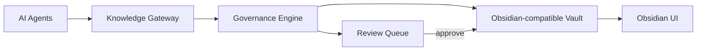

# Obsidian Agent KB

**A local-first knowledge operating system for AI agents, powered by Obsidian-compatible Markdown.**

Obsidian Agent KB gives every AI agent a shared, auditable, long-term memory layer.  
It is not another vector database. It is a governed Markdown-native knowledge system.

## Why

AI agents forget. Chat history is scattered. Notes become digital garbage.

Obsidian Agent KB solves this with:

- **Agent-native access** through MCP, CLI, and connectors
- **Obsidian-compatible Markdown**
- **Automatic ingestion and distillation**
- **Human review before canonicalization**
- **Data governance by design**
- **Git-versioned memory**
- **Local-first storage**

## Core value

```text
Fragmented agent messages
  → governed intake
  → purified knowledge
  → reviewable memory
  → precise agent context
```

## Architecture



## Packages

| Package | Purpose |
|---|---|
| `@oakb/core` | Vault model, frontmatter parser, governance engine, lifecycle rules |
| `@oakb/mcp` | MCP server for AI agents |
| `@oakb/cli` | Local CLI for humans and fallback agents |
| `@oakb/obsidian-plugin` | Human review dashboard and promotion UI |
| `connectors` | Examples and adapters for agent platforms |

## Status

`0.1.0-alpha` — architecture and governance model under active development.

## License

Apache-2.0.
