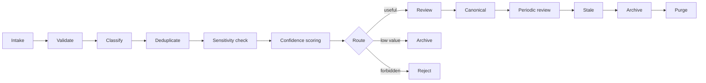

# Data Governance

**Languages:** [中文](data-governance.md) | English

Governance is not cleanup.  
Governance is the mechanism that prevents knowledge from becoming garbage.

## Principle

```text
Not everything captured is knowledge.
Not everything generated should be retained.
Not everything trusted should be canonical.
```

## Governance pipeline



## Required metadata

Every governed object must carry:

```yaml
id:
type:
title:
status:
source:
origin:
confidence:
sensitivity:
owner:
created:
updated:
reviewed_at:
review_by:
retention:
expires_at:
tags:
```

Minimum required at intake:

```yaml
id
type
title
status
source
origin
confidence
sensitivity
created
updated
tags
```

## Provenance

Every object must answer:

```text
Who created it?
Which agent produced it?
What source does it come from?
When was it created?
What prompt or task produced it?
Was it human-reviewed?
```

Example:

```yaml
provenance:
  origin: agent
  agent_id: codex
  task_id: task-123
  model: gpt-5.3
  source_path: 06-sources/reports/example.md
  prompt_hash: sha256:...
  reviewed_by: human
```

## Knowledge quality score

Each candidate is scored from `0` to `100`.

| Dimension | Weight | Question |
|---|---:|---|
| Provenance | 20 | Can we trace the origin? |
| Actionability | 20 | Can an agent reuse this for a decision? |
| Uniqueness | 15 | Is this materially new? |
| Evidence | 15 | Is it supported by source or validation? |
| Freshness | 10 | Is it still current? |
| Specificity | 10 | Is it concrete rather than vague? |
| Sensitivity safety | 10 | Is it safe to retain? |

Routing:

| Score | Route |
|---:|---|
| `0-39` | reject or archive |
| `40-59` | temporary retention |
| `60-79` | review |
| `80+` | eligible for canonical review |

## Sensitivity classes

| Class | Meaning | Default policy |
|---|---|---|
| `public` | safe to share | retain |
| `internal` | local/team use | retain |
| `confidential` | restricted | review required |
| `personal` | personal data | redact or review |
| `secret` | credential or key | reject |

## Duplicate policy

A duplicate is detected when:

1. normalized title similarity exceeds threshold
2. body hash matches
3. semantic fingerprint matches
4. same source produces the same conclusion without new evidence

Actions:

```text
exact duplicate       → reject
near duplicate        → merge
conflicting duplicate → conflict review
same source update    → version
```

## Retention

| Type | Default retention |
|---|---|
| raw agent message | 30 days unless promoted |
| source document | retain while referenced |
| knowledge card | review every 180 days |
| decision | retain indefinitely |
| failed/low-quality card | 7 days |
| archived item | policy-dependent |

## Promotion rules

A card becomes canonical only if:

1. governance score is `80+`
2. sensitivity is not `secret`
3. provenance is complete
4. no duplicate conflict exists
5. review policy passes
6. human approval or trusted auto-policy exists

## Demotion rules

Demote or archive when:

1. source is invalidated
2. evidence conflicts with canonical decision
3. content is superseded
4. no access in retention window
5. review is overdue
6. knowledge is too vague to act on

## Governance events

Every action should emit an event:

```yaml
event: knowledge.promoted
object_id: kb-2026-01-01-example
actor: human:ken
from: 03-knowledge/auto
to: 03-knowledge/canonical
reason: verified against source
timestamp: 2026-01-01T00:00:00Z
```

Core events:

```text
intake.accepted
intake.rejected
intake.redacted
duplicate.detected
knowledge.created
knowledge.reviewed
knowledge.promoted
knowledge.demoted
knowledge.archived
knowledge.purged
policy.violation
```

## Human review contract

Humans do not review everything.

Humans review:

1. canonical promotion
2. conflicting knowledge
3. confidential material
4. irreversible deletion
5. policy exceptions

Agents handle the rest.
