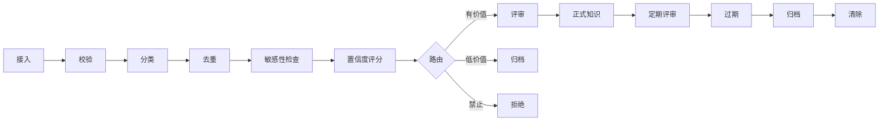

# 数据治理

**语言：** 中文 ｜ [English](data-governance.en.md)

治理不是简单清理。

治理是防止知识逐渐失去价值的机制。

## 原则

```text
并非所有被捕获的内容都是知识。
并非所有生成的内容都应该保留。
并非所有可信内容都应该成为正式知识。
```

## 治理流程



## 必需的元数据

每个受治理对象都必须携带：

```yaml
id:
type:
title:
status:
source:
origin:
confidence:
sensitivity:
owner:
created:
updated:
reviewed_at:
review_by:
retention:
expires_at:
tags:
```

接入时至少要求：

```yaml
id
type
title
status
source
origin
confidence
sensitivity
created
updated
tags
```

## 来源追踪

每个对象都必须能够回答：

```text
谁创建了它？
哪个 Agent 生成了它？
它来自什么来源？
它何时创建？
什么提示词或任务生成了它？
它是否经过人工评审？
```

示例：

```yaml
provenance:
  origin: agent
  agent_id: codex
  task_id: task-123
  model: gpt-5.3
  source_path: 06-sources/reports/example.md
  prompt_hash: sha256:...
  reviewed_by: human
```

## 知识质量评分

每个候选对象按 `0` 到 `100` 分评分。

| 维度 | 权重 | 评估问题 |
|---|---:|---|
| 来源追踪 | 20 | 能否追溯来源？ |
| 可行动性 | 20 | Agent 能否将其复用于决策？ |
| 独特性 | 15 | 是否具有实质性新增信息？ |
| 证据 | 15 | 是否有来源或验证支撑？ |
| 新鲜度 | 10 | 是否仍然有效？ |
| 具体性 | 10 | 是否具体而非含糊？ |
| 敏感性安全 | 10 | 是否适合保留？ |

路由：

| 分数 | 路由 |
|---:|---|
| `0-39` | 拒绝或归档 |
| `40-59` | 临时保留 |
| `60-79` | 评审 |
| `80+` | 可进入正式知识评审 |

## 敏感级别

| 级别 | 含义 | 默认策略 |
|---|---|---|
| `public` | 可安全共享 | 保留 |
| `internal` | 本地或团队使用 | 保留 |
| `confidential` | 受限内容 | 必须评审 |
| `personal` | 个人数据 | 脱敏或评审 |
| `secret` | 凭据或密钥 | 拒绝 |

## 重复内容策略

满足以下任一情况时，识别为重复：

1. 规范化标题相似度超过阈值
2. 正文哈希一致
3. 语义指纹一致
4. 同一来源在没有新证据的情况下产生相同结论

处理动作：

```text
完全重复       → 拒绝
近似重复       → 合并
冲突重复       → 冲突评审
同来源更新     → 新版本
```

## 保留策略

| 类型 | 默认保留方式 |
|---|---|
| 原始 Agent 消息 | 除非晋升，否则保留 30 天 |
| 来源文档 | 被引用期间持续保留 |
| 知识卡 | 每 180 天评审一次 |
| 决策 | 无限期保留 |
| 失败或低质量卡片 | 7 天 |
| 已归档对象 | 取决于策略 |

## 晋升规则

卡片只有满足以下条件才能成为正式知识：

1. 治理评分达到 `80+`
2. 敏感级别不是 `secret`
3. 来源追踪信息完整
4. 不存在重复冲突
5. 通过评审策略
6. 获得人工批准或符合可信自动策略

## 降级规则

出现以下情况时，应降级或归档：

1. 来源已失效
2. 证据与正式决策冲突
3. 内容已被取代
4. 保留窗口内没有访问
5. 评审已逾期
6. 知识过于含糊，无法据此行动

## 治理事件

每个动作都应产生事件：

```yaml
event: knowledge.promoted
object_id: kb-2026-01-01-example
actor: human:ken
from: 03-knowledge/auto
to: 03-knowledge/canonical
reason: verified against source
timestamp: 2026-01-01T00:00:00Z
```

核心事件：

```text
intake.accepted
intake.rejected
intake.redacted
duplicate.detected
knowledge.created
knowledge.reviewed
knowledge.promoted
knowledge.demoted
knowledge.archived
knowledge.purged
policy.violation
```

## 人工评审契约

人工不需要评审所有内容。

人工负责评审：

1. 正式知识晋升
2. 冲突知识
3. 机密材料
4. 不可逆删除
5. 策略例外

其余内容由 Agent 处理。
